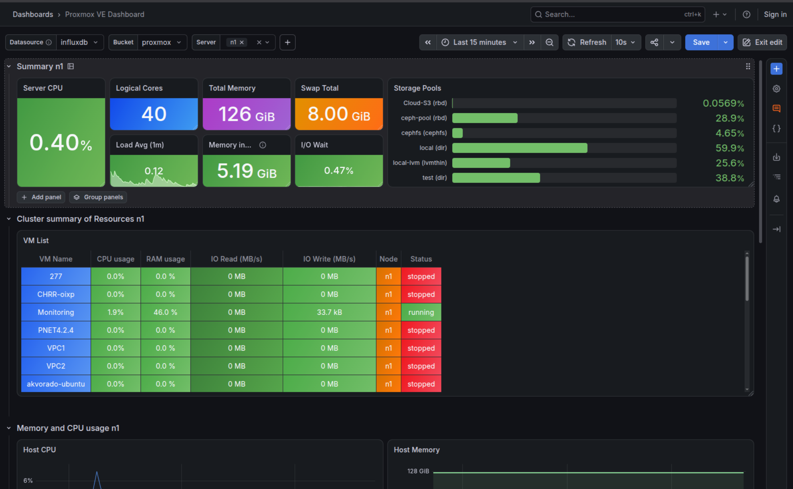

# Proxmox VE & Ceph Monitoring dengan InfluxDB & Grafana

Dokumentasi ini berisi cara mengintegrasikan sistem **real-time monitoring Proxmox VE** serta **Ceph Cluster** menggunakan **Telegraf** sebagai agen pengumpul data, **InfluxDB** sebagai *Time-Series Database*, dan **Grafana** sebagai platform visualisasi serta *alerting*.

---

<p align="center">
  
</p>

---

## 🏗️ Arsitektur Sistem

```
┌────────────────┐      Metrics      ┌──────────────┐
│  Proxmox VE    │ ────────────────> │   InfluxDB   │
│   (Metrics)    │   Port 8086/HTTP  │ (Time-Series)│
└────────────────┘                   └──────┬───────┘
                                            │
┌────────────────┐      Metrics      ┌──────▼───────┐
│  Ceph Cluster  │ ────────────────> │   Grafana    │
│   (Telegraf)   │   Input: Ceph     │ (Dashboard)  │
└────────────────┘                   └──────┬───────┘
                                            │
                                            ▼
                                     ┌──────────────┐
                                     │   Telegram   │
                                     │     Bot      │
                                     └──────────────┘
```

### Komponen

| Komponen     | Fungsi                          | Port |
| ------------ | ------------------------------- | ---: |
| Proxmox VE   | Metric Source (Internal)        | 8006 |
| Telegraf     | Ceph Metric Collector           | -    |
| InfluxDB     | Storage (Time-series)           | 8086 |
| Grafana      | Dashboard & Alerting            | 3000 |

---

# 🚀 Instalasi & Konfigurasi

## 1. Konfigurasi InfluxDB
Siapkan **Organization**, **Bucket** (misal: `proxmox` dan `ceph`), dan **API Token** di InfluxDB.

---

## 2. Menghubungkan Proxmox VE ke InfluxDB
Di GUI Proxmox: `Datacenter` → `Metric Server` → `Add` → `InfluxDB`.

---

## 3. Monitoring Ceph dengan Telegraf

Untuk memantau Ceph, gunakan **Telegraf** pada node Proxmox/Ceph.

### 3.1 Install Telegraf atau bisa pakai Dockerize
```bash
apt update && apt install telegraf
```

### 3.2 Konfigurasi Telegraf (`/config/telegraf/telegraf.conf`)
Tambahkan input plugin untuk Ceph:

```toml
[[inputs.ceph]]
  ## Path to ceph config file
  ceph_config = "/etc/ceph/ceph.conf"
  ## Path to ceph keyring file
  ceph_user = "admin"
  ceph_keyring = "/etc/ceph/ceph.client.admin.keyring"

[[outputs.influxdb_v2]]
  urls = ["http://<IP-INFLUXDB>:8086"]
  token = "<TOKEN>"
  organization = "<ORG>"
  bucket = "ceph"
```
jika tidak memakai docker maka harus , instal telegraf satu-persatu di semua node dan ikuti https://docs.ceph.com/en/latest/mgr/telegraf/

Restart telegraf:
```bash
systemctl restart telegraf
```

---

# 📊 4. Integrasi Grafana
Tambahkan Data Source InfluxDB di Grafana (Query Language: **Flux**). Buat dashboard dengan panel untuk memantau:
* **Proxmox:** CPU, RAM, Network, Storage.
* **Ceph:** Cluster Health, OSD Status, PG States, IOPS/Throughput.

---

# 📱 5. Integrasi Telegram
Konfigurasikan **Contact Point** Telegram di Grafana untuk menerima alert terkait kondisi cluster Proxmox maupun Ceph.

---

# 🧪 6. Checklist Deployment

```text
[✅] InfluxDB bucket "proxmox" & "ceph" aktif
[✅] Proxmox Metric Server terkonfigurasi
[✅] Telegraf terinstall di node Ceph
[✅] Telegraf terhubung ke InfluxDB
[✅] Grafana dashboard terbuat untuk Proxmox & Ceph
[✅] Telegram alert terkonfigurasi
```
